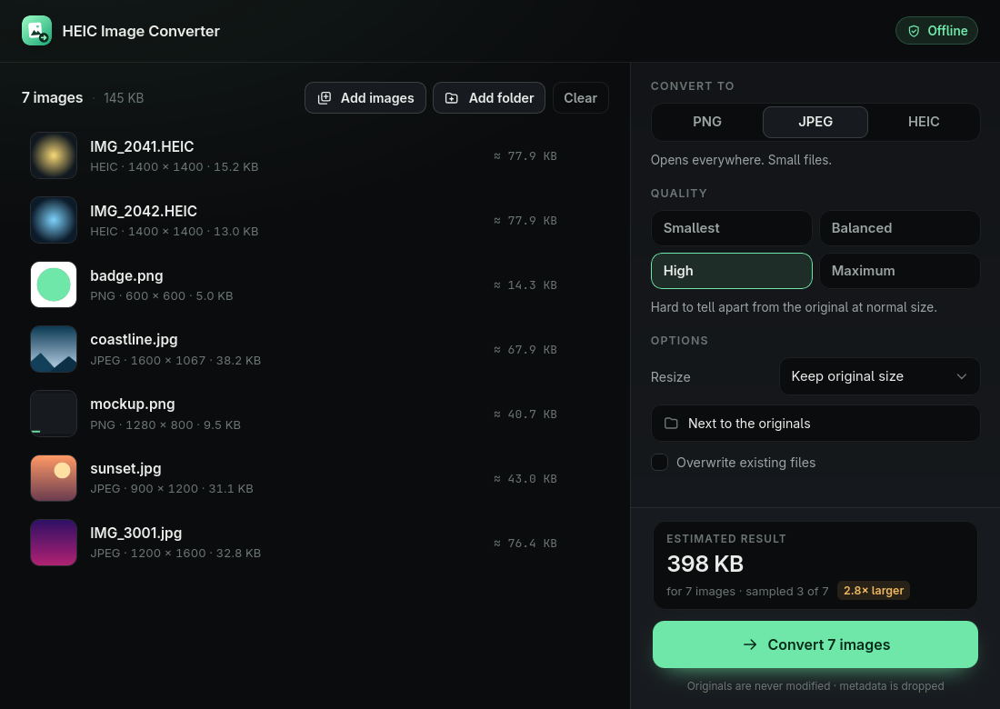

# HEIC Image Converter

A clean, fast, offline desktop app for converting images — built because
converting HEIC photos should not require uploading your camera roll to a
website that swears it only touches them "client side".

HEIC ⇄ JPEG ⇄ PNG. One file, a shortlist, or an entire folder tree. No
accounts, no cloud, no telemetry.



## Why this exists

- **HEIC is everywhere and nothing opens it.** Free GUI converters either
  don't exist, are Windows-only, or are buried in a shareware installer.
- **Online converters want your files.** Even the "client-side" ones are a
  promise you cannot verify. This app never opens a socket.
- **CLI tools are fine if you already live in a terminal.** Most people don't.

## Features

- Convert **HEIC/HEIF to JPEG or PNG**, and **JPEG/PNG/WebP/TIFF/BMP/GIF to
  HEIC** (or to each other).
- Drop **single files, a selection, or whole folders** — subfolders are walked
  recursively and the folder structure is mirrored on output.
- **Quality in plain language**: Smallest, Balanced, High, Maximum. The codec
  number is an implementation detail; you pick the trade-off.
- **Honest size estimates**: the app actually encodes a few of *your* images at
  the chosen settings and extrapolates by pixel count. Shown before you commit,
  with the exact size after.
- Optional **resize** (longest edge), preserve-subfolders output, and safe
  naming — it never silently clobbers an existing file.
- **EXIF orientation is respected**, so portrait phone photos don't come out
  sideways.
- **Verified on Linux** — one machine, one dated run (2026-11-18), recorded in
  [docs/BEHAVIOR.md](docs/BEHAVIOR.md); not a general Linux guarantee. Same
  Rust pipeline, no ImageMagick, no Homebrew, no "install these 4 codecs
  first". Windows and macOS builds are configured but have never been run —
  stages 05 and 06 own those platforms.

## Install

No release has been published yet: the release workflow is configured but has
not been exercised end-to-end, so there are no downloadable builds.

Build from source with `npm run tauri build` (see below); on Arch you can also
wrap the result in a PKGBUILD.

## Build from source

Prerequisites: [Rust](https://rustup.rs), Node 20+, and the
[Tauri v2 system dependencies](https://v2.tauri.app/start/prerequisites/) for
your platform (on Arch: `webkit2gtk-4.1 libsoup3 gtk3 librsvg`).

```bash
npm install
npm run tauri dev       # development window with hot reload
npm run tauri build     # installers in src-tauri/target/release/bundle
```

The codec archives are pinned by a committed manifest
(`src-tauri/vendor/heif-bundles/manifest.json`) and checksum-verified before
extraction. Four ship in the repo — Linux x64, macOS x64, macOS arm64, and
Windows x64 — so a clean checkout has the codec locally for every shipping
target. The other four are hash-pinned and fetched on demand with
`scripts/heif-artifacts.sh fetch <archive>`.
`HEIF_BINARIES_DIR=/path/to/extracted` still overrides the artifact for a local
or custom codec build.

On the Rust side, `scripts/ci.sh offline` proves the test gate builds and tests a
`git clone` of HEAD with no route to the network; `npm ci`, Vite, and the Tauri
release build are outside that claim ([details](docs/BUILD.md#offline-builds)).

### Windows and macOS

Cross-compiling a Tauri app from Linux is not practical (WebView2, signing,
platform SDKs). Push a tag and let
[`.github/workflows/release.yml`](.github/workflows/release.yml) build all
three platforms on GitHub's runners, or build natively on the target OS.

## How it works

```
React + TypeScript (Vite)  ──invoke──▶  Rust / Tauri commands
                                            │
                              image crate ──┤  JPEG, PNG, WebP, TIFF, BMP, GIF
                              heif-rs ──────┘  HEIC/HEIF via libheif + libde265/x265
```

- `src-tauri/src/scan.rs` expands drops, filters hidden files, probes
  dimensions, and renders 128 px thumbnails.
- `src-tauri/src/decode.rs` decodes HEIC (libheif) or anything else (`image`)
  and applies EXIF orientation where the container doesn't already have it.
- `src-tauri/src/convert.rs` resizes, encodes, picks a collision-free output
  path, and reports progress per file over a Tauri event. PNG output is always
  8-bit, so a 10-bit HEIC does not silently double its file size.
- `src-tauri/src/estimate.rs` sample-encodes up to three images and returns
  bytes-per-pixel for the UI's estimate.
- Conversion runs on a bounded thread pool sized per output format; HEIC gets
  fewer workers because x265 already uses every core. Dimensions are probed in
  parallel during a scan.

## Documentation

The [docs](docs/) folder is the project's review trail:

- [Architecture](docs/ARCHITECTURE.md) — modules, IPC, threading, output rules.
- [Behavior](docs/BEHAVIOR.md) — user-facing behavior and a verification matrix
  that is explicit about what has and has not been tested.
- [Decisions](docs/DECISIONS.md) — why it is built this way, and the cost of
  each choice.
- [Build](docs/BUILD.md) — prerequisites, packaging, CI, troubleshooting.
- [SSC handoff](docs/SSC-HANDOFF.md) — briefing for converting this prototype
  into an SSC project (`ssc-plan` brownfield adoption).

## Privacy

All processing is local. The app ships with a Content Security Policy that
permits its own assets plus the Vite dev origins (`ws://localhost:1420` and
`http://localhost:1420`) used for hot reload — a recorded defect owned by
stage 04. No runtime network capture has been performed; the capture and the
policy tightening are deferred to stage 04. It deliberately does **not** copy
EXIF metadata (including GPS location) to the output.

## License

GPL-3.0-or-later. See [LICENSE](LICENSE).

The bundled codec stack and its license obligations are recorded in
[THIRD-PARTY-NOTICES.md](THIRD-PARTY-NOTICES.md).

The strong copyleft is a direct consequence of bundling **x265** for HEIC
encoding, which is GPL-licensed. If you need a permissively licensed build,
remove the `Heic` output variant and the `heif-rs` encoder side.
